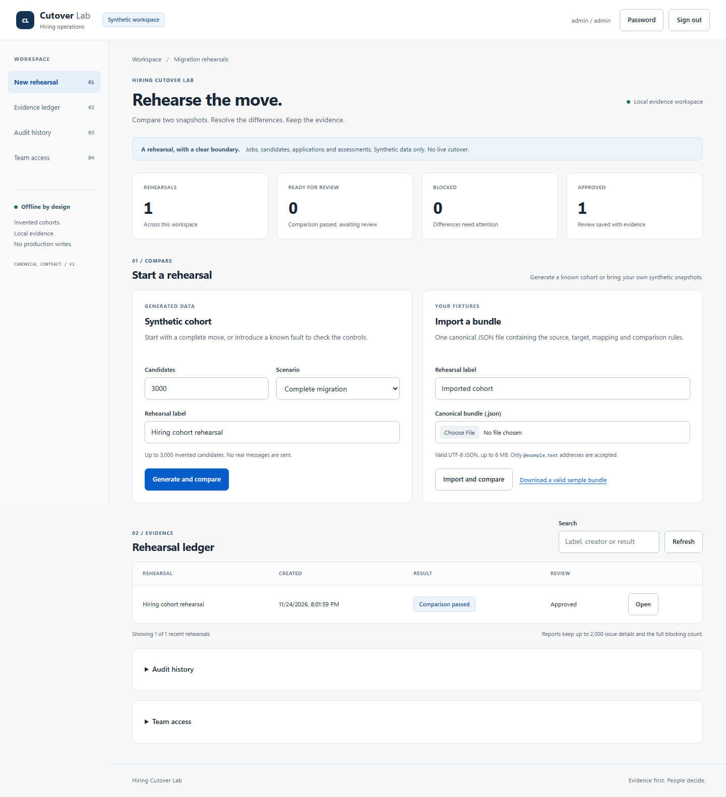
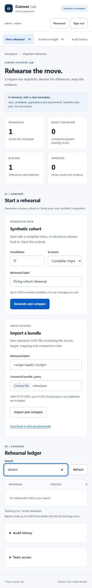
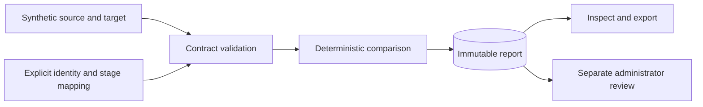

# Hiring Cutover Lab

An offline hiring migration rehearsal with explicit mappings, blocking differences and reviewable evidence.

[](https://github.com/MokiMeow/hiring-cutover-lab/actions/workflows/ci.yml) [](package.json) [](LICENSE)

A migration can have matching row counts and still lose relationships, stages or assessment results. Cutover compares two canonical snapshots through explicit identity mappings, blocks every detected issue, and binds a separate administrator review to the saved report.

**This is a synthetic, offline rehearsal tool.** It has no live ATS connector or production migration writer. [Real-use boundaries](docs/REAL-USE.md).



<details>
<summary>Mobile layout</summary>



</details>

## Quick start

Requires **Node.js 24.22+** and npm. Runtime uses Node's HTTP, crypto and SQLite modules; there are no external runtime services or packages. Dependencies are pinned development tooling and vendored UI assets.

```sh
git clone https://github.com/MokiMeow/hiring-cutover-lab.git
cd hiring-cutover-lab
npm ci --ignore-scripts
npm run demo
```

Open the loopback URL printed by the server, normally **http://127.0.0.1:4312**. Sign in as `admin` using the random bootstrap password printed on the first demo run. Keep it: on later runs set `CUTOVER_BOOTSTRAP_PASSWORD` to that existing password. The setting never resets an existing account. Stop with Ctrl+C.

Windows users can also run `Start-Demo.ps1`. It installs no service or watcher. Browser assets are local, with no remote fonts or CDN runtime requests.

## What it does

| Workflow   | Behavior                                                                               |
| ---------- | -------------------------------------------------------------------------------------- |
| Input      | Generate an invented cohort or import a strict canonical JSON bundle                   |
| Comparison | Explicit one-to-one IDs, entity completeness, relationships, stages, status and scores |
| Policy     | Exact comparisons by default; visible, hashed stage and whitespace rules               |
| Evidence   | Deterministic issues, immutable saved reports, JSON/CSV exports and provenance hashes  |
| Review     | A separate administrator action tied to the exact report hash                          |
| Access     | Admin, operator and viewer roles, revocable sessions and local audit history           |

## How it works



Try the CLI without starting the UI:

```sh
node src/cli.mjs compare public/contract.json
```

Exit 0 means ready for rehearsal review, 2 means blocked, and 1 means invalid input or an operational error. [Dataset contract](docs/CONTRACT.md).

## Verify

```sh
npx --no-install playwright install chromium --only-shell
npm run verify
```

Verification checks syntax, unit/API tests, the required Playwright journeys, report acceptance and a real CLI/HTTP smoke run. Browser tests use one isolated headless worker and zero retries. Set `BROWSER_PATH` only when using a separate compatible Chromium executable. CI runs the same verification on Node 24 and 26.

See [validation and recorded results](docs/RESULTS.md) for the fault probe, optional strict-engine checks and security coverage. Test data and generated reports remain outside Git.

## Scope and limits

Only invented snapshots with `synthetic:true` and `example.test` addresses are accepted. The v1 contract covers jobs, candidates, applications and assessments. Matching declared counts is not independent proof of a complete vendor export. Attachments, consent, notes, offers and custom fields require a separate contract extension.

## Read more

Start with the [documentation index](docs/README.md), [architecture](docs/ARCHITECTURE.md), [operating runbook](docs/OPERATIONS.md) and [readiness](docs/READINESS.md). Contributions follow [CONTRIBUTING.md](CONTRIBUTING.md). Report vulnerabilities through [SECURITY.md](SECURITY.md).

## License

[MIT](LICENSE). Vendored Bootstrap CSS and optional Apiiro scanner rules retain their own notices. See [third-party notices](NOTICE.md).
