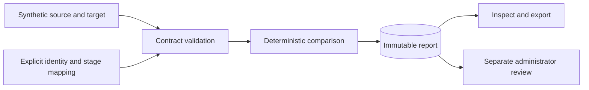

# Architecture

## Module map

| Module            | Responsibility                                                |
| ----------------- | ------------------------------------------------------------- |
| src/engine.mjs    | Canonical validation, deterministic comparison and provenance |
| src/synthetic.mjs | Invented cohorts and explicit seeded faults                   |
| src/auth.mjs      | Users, roles and expiring sessions                            |
| src/store.mjs     | Immutable reports, reviews, users and audit persistence       |
| src/server.mjs    | Authenticated comparison, evidence and team HTTP/UI routes    |
| src/cli.mjs       | Bounded input files and JSON/CSV report output                |
| src/password.mjs  | Argon2id credentials and legacy hash migration                |
| public/           | Local responsive UI and vendored stylesheet                   |
| test/ and e2e/    | Domain, HTTP, persistence, recovery and browser checks        |
| scripts/          | Syntax, CLI smoke and source-bound verification evidence      |
| security/         | Optional scan orchestration and pinned rule repairs           |

## Boundaries

Only invented snapshots with `synthetic:true` and `example.test` addresses are accepted. The v1 contract covers jobs, candidates, applications and assessments. Matching declared counts is not independent proof of a complete vendor export. Attachments, consent, notes, offers and custom fields require a separate contract extension.

The browser receives public assets and authenticated application data. Credentials are server-side. Writes require role checks, CSRF protection and exact origin validation. Sessions expire and account changes revoke access. SQL uses prepared statements. JSON input is bounded and malformed UTF-8 is rejected.

SQLite persists domain state and local audit history. Authentication and audit mutations commit together. Foreign application databases are rejected before migration. A backup and its restored instance require the same access protection as the original disk. Local report hashes detect inconsistent content; they are not signatures or an external immutable ledger.

Asynchronous UI responses are fenced by session, selection and modal generation. Older responses cannot change a newer account, retarget a record action or reset a newly opened draft. Native dialogs preserve keyboard focus and nonessential motion is disabled.
